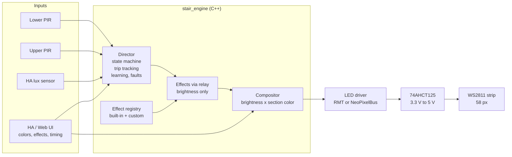
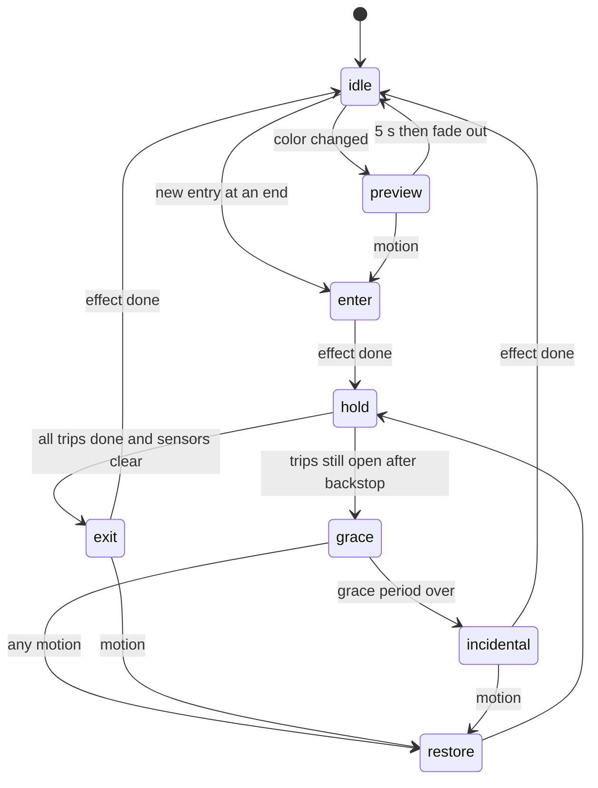
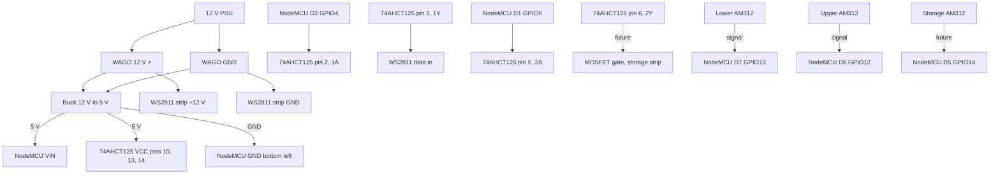
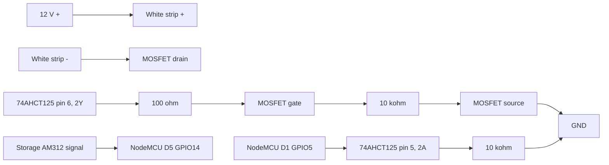
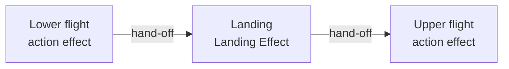
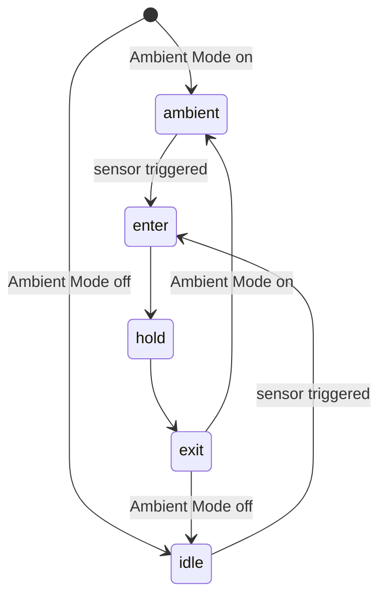

# Stairwell Lighting (stair_engine)

Direction-aware, sectioned LED stair lighting for ESPHome and Home Assistant.

Walk up and the stairs light ahead of you from the bottom. Walk down and they
light from the top. When you reach the other end they turn off behind you, in
the direction you walked. A ball rolling past a sensor gets its own short
"incidental" animation instead of a full light show. Every section has its own
color, every action has its own effect, and the hold time learns how long your
household actually takes on the stairs.

All behavior lives in a small C++ engine that compiles and runs on a PC for
testing (1,658 automated checks), then runs unchanged on an ESP8266 or ESP32.

  

---

## Contents

- [Features](#features)
- [How it works](#how-it-works)
- [Hardware](#hardware)
- [Wiring and pinouts](#wiring-and-pinouts)
- [Storage room light (future)](#storage-room-light-future)
- [Build and flash](#build-and-flash)
- [Home Assistant / Web UI settings](#home-assistant--web-ui-settings)
- [Effects](#effects)
- [Relay (landing effect)](#relay-landing-effect)
- [Using it](#using-it)
- [Why it is built this way](#why-it-is-built-this-way)
- [Troubleshooting](#troubleshooting)
- [Testing](#testing)
- [Project files](#project-files)
- [Extending](#extending)
- [Future effects and ambient mode](#future-effects-and-ambient-mode)
- [Known limits](#known-limits)
- [Roadmap](#roadmap)
- [Changelog](#changelog)

---

## Features

- **Three actions, handled differently:** going up, going down, and incidental
  triggers (pets, a ball, a sensor glitch).
- **Sections:** the strip is split into independently colored sections. This
  install uses three: lower flight, landing, upper flight. Up to 8 are supported.
- **Live per-section color** from a Home Assistant color wheel. Changing a color
  lights just that section for 5 seconds so you can see it in place.
- **Effect per action** from a dropdown: 7 traversal effects (Cascade, Soft Wipe,
  Comet, Fade, Glitch, Stagger, Scatter) and 6 incidental effects (Retreat,
  Firefly, Ripple, Breath, Peek, Sonar). Effects never contain colors; they only
  shape brightness, and color always comes from the section.
- **Relay landing effect:** the landing can run its own effect. The action's
  effect carries you to the landing, hands off, and takes back over for the
  next flight, in your direction of travel.
- **Custom effects in one file:** effects register by name, so adding one means
  editing `stair_effects_custom.cpp` and adding its name to a dropdown.
- **Hold until confirmed:** lights stay on until the person is seen arriving at
  the other end. No fixed timer turns the lights off on a slow climber.
- **Learned backstop:** for trips that never complete (turn-backs, false
  triggers), the timeout adapts to how long real trips take in your home.
- **Grace dim:** before giving up, the stairs dim instead of snapping off. Any
  motion brings them straight back.
- **Sensor fault detection:** a false-triggering or stuck PIR is flagged in Home
  Assistant and can no longer hold the lights on forever.
- **Ambient gating:** optional daylight suppression from any HA lux sensor.
- **Simulate buttons** to demo or test every action without walking the stairs.
- **Dual target:** one YAML file builds for ESP8266 or ESP32.
- **Future storage room light:** a PIR-controlled 12 V white strip on the same
  controller, enabled with one line in the config.

---

## How it works

### Architecture



### Lighting phases



### Trip tracking

With only two sensors there is no way to see what happens mid-stairs, so the
engine keeps a short queue of open trips per direction:

- A trigger at the bottom with no open "down" trip is a **new up trip**.
- A trigger at the top while an "up" trip is open (and at least 0.8 s old) is
  that trip **completing**. The time it took is recorded for learning.
- Lights exit only when **every** trip has completed and both sensors are clear.

Two people, someone turning back, or a ball all leave trips open. Those are
resolved by the backstop: hold, then grace dim, then the incidental effect.

### Learned backstop

Each completed trip time is stored (the last 16 per direction, saved to flash at
most once a minute). The backstop is:

```
backstop = 2 x (90th percentile trip time), clamped to [Hold Minimum, Hold Maximum]
```

Until 3 trips have been learned in a direction, Hold Maximum is used. Simulated
trips never train it. Example: if your trips up take 4 to 6 s, the backstop is
about 12 s, raised to the 20 s Hold Minimum.

### Sensor faults

A PIR that keeps firing with nobody there would otherwise hold the lights on
indefinitely. The engine flags a sensor as faulted when either:

- it produces **5 new entries within 3 minutes, none of which complete**, or
- it stays **continuously active for 5 minutes**.

While faulted, that sensor can still **wake dark stairs** (a real person is
never left in the dark), but it cannot hold them on, add phantom trips, or
complete trips. Trips started by it time out at Hold Minimum. The fault clears
automatically after 10 quiet minutes, or with the Clear Sensor Faults button.

---

## Hardware

### Installed controller

| Part | Notes |
|---|---|
| HiLetgo NodeMCU v1.0 (ESP8266MOD, ESP-12E, CP2102) | 4 MB flash. ESPHome board `nodemcuv2` |
| NodeMCU screw-terminal carrier board | with a perfboard area |
| SN74AHCT125N | 3.3 V to 5 V level shifter for LED data, powered from 5 V |
| Buck converter module, 12 V to 5 V | feeds NodeMCU VIN and the 74AHCT125 |
| 12 V power supply | LED strip and buck input |
| WS2811 12 V addressable strip | 58 pixels (driver ICs), BRG order |
| 2x AM312 mini PIR | 3.3 V, about 15 uA, fixed ~2 s output pulse |
| 4-core cable per sensor | red +, white -, green signal, blue ground guard |
| WAGO 221 lever connectors | power distribution |
| Enclosure | |

### Recommended additions

| Part | Qty | Where | Why |
|---|---|---|---|
| 100 nF ceramic capacitor | 1 | 74AHCT125 pin 14 to pin 7 | local decoupling for the shifter |
| 100 ohm resistor | 1 per PIR | in series with PIR + at the sensor | RC filter (see below) |
| 100 uF electrolytic capacitor | 1 per PIR | PIR VCC to GND at the sensor | RC filter |
| 100 nF ceramic capacitor | 1 per PIR | PIR VCC to GND at the sensor | RC filter, high frequency |
| 10 kohm resistor | 1 | 74AHCT125 pin 5 to GND | keeps the storage gate low while the ESP boots |

### Optional ESP32 build

ESP32 WROOM-32 (`esp32dev`), ESP-IDF, RMT LED driver. Same engine and features,
a higher frame rate, and internal pulldowns on the PIR pins. Set `board: esp32`.

---

## Wiring and pinouts

### System overview



### NodeMCU carrier terminals (as installed)

Right-hand block, top to bottom:

| Terminal | GPIO | Connection | Notes |
|---|---|---|---|
| D0 | 16 | none | tied to the onboard LED, avoid for inputs |
| D1 | 5 | 74AHCT125 pin 5 (2A) | storage strip control (future). Driven LOW by firmware |
| D2 | 4 | 74AHCT125 pin 2 (1A) | stair strip data |
| D3 | 0 | none (old temp sensor harness removed) | boot pin, keep free |
| D4 | 2 | none | boot pin, avoid |
| 3V3 | | lower PIR + (red) | through the RC filter at the sensor |
| GND | | lower PIR - (white) and lower guard (blue) | guard grounded here only |
| D5 | 14 | none | reserved for the storage PIR (future) |
| D6 | 12 | upper PIR signal (green) | |
| D7 | 13 | lower PIR signal (green) | |
| D8 | 15 | none | boot pin, avoid |
| RX | 3 | none | alternate DMA pin for the stair strip |
| TX | 1 | none | serial log output |
| GND | | upper PIR - (white) | |
| 3V3 | | none | |

Left-hand block:

| Terminal | Connection |
|---|---|
| VIN | 5 V from the buck converter |
| 3V3 | upper PIR + (red), through the RC filter at the sensor |
| GND (top) | upper guard (blue) |
| GND (bottom) | GND from the buck converter |

All GND terminals are the same net. Each guard conductor is grounded **at the
controller end only**; leave the far end unconnected.

### 74AHCT125 level shifter

```
               +---\/---+
 1OE   GND    -|1     14|- VCC  5 V
 1A    D2     -|2     13|- 4OE  5 V   (gate 4 disabled)
 1Y    strip  -|3     12|- 4A   GND
 2OE   GND    -|4     11|- 4Y   n/c
 2A    D1     -|5     10|- 3OE  5 V   (gate 3 disabled)
 2Y    MOSFET -|6      9|- 3A   GND
 GND          -|7      8|- 3Y   n/c
               +--------+
```

| Gate | Input | Output | State |
|---|---|---|---|
| 1 | D2 / GPIO4 | WS2811 data | active |
| 2 | D1 / GPIO5 | storage MOSFET gate (future) | active, input held LOW by firmware |
| 3 | GND | n/c | disabled (OE high) |
| 4 | GND | n/c | disabled (OE high) |

OE is active LOW: a gate is enabled when its OE pin is grounded.

### PIR sensor wiring with RC filter

The AM312 is known to false-trigger from supply ripple, and the NodeMCU's 3.3 V
regulator also feeds the ESP8266, whose Wi-Fi bursts pull hundreds of mA. The
AM312 draws only about 15 uA, so a series resistor plus capacitors **at the
sensor** filters the ripple with a negligible 1.5 mV drop:

```
 controller end                          sensor end
 3V3  ------ red ------[ 100 ohm ]---+------+------ AM312 VCC
                                     |      |
                                  100 uF  100 nF
                                     |      |
 GND  ------ white ------------------+------+------ AM312 GND
 GPIO ------ green -------------------------------- AM312 OUT
 GND  ------ blue (guard) ------------------- x     (far end NOT connected)
```

The filter corner is about 16 Hz.

---

## Storage room light (future)

A plain 12 V white strip (two wires, + and -) only needs on and off with a fade,
so it does not need an addressable strip. A logic-level N-channel MOSFET
switches its negative side. The existing 74AHCT125 gate 2 provides a 5 V gate
drive, which fully turns on common logic-level MOSFETs. PWM from the ESP gives
smooth fades.

### Parts

| Part | Example | Notes |
|---|---|---|
| Logic-level N-MOSFET, TO-220 | IRLZ44N (used here) or IRLB8721PbF | do **not** use IRF520 modules; they are not logic-level |
| Gate resistor | 100 ohm | limits ringing |
| Gate pulldown | 10 kohm, gate to source | the MOSFET stays off if the drive is lost |
| Boot pulldown | 10 kohm, 74AHCT125 pin 5 to GND | gate 2 input stays LOW while GPIO5 floats during boot |
| AM312 and RC filter | as above | wired to D5 |
| 12 V white strip | | check its current draw against the PSU |

An IRLB8721 runs cool with no heatsink up to several amps. LED strips need no
flyback diode.

### Storage wiring



```
 12 V + -------------------------------- strip +
                                         strip - ---- D (drain)
 74AHCT125 pin 6 ---[100 ohm]---+------------------- G (gate)
                                |
                             [10 kohm]
                                |
 GND ---------------------------+------------------- S (source)

 IRLB8721 / IRLZ44N, TO-220, facing the label: G D S (left to right)
```

### Enabling it

1. Wire the MOSFET, strip, and PIR as above.
2. In `stairwell-lighting.yaml`, set `storage_installed: true`.
3. Flash. New entities appear: **Storage Light**, **Storage Motion**,
   **Storage Off Delay**, **Storage Brightness**, **Storage Motion Control**.

Behavior: motion fades the light up to Storage Brightness over 1 s. When motion
clears, a restartable timer waits Storage Off Delay, then fades out over 2 s.
New motion during the wait cancels the timer. Turn off Storage Motion Control
to run the light manually from Home Assistant.

Until `storage_installed` is true, the firmware still drives GPIO5 LOW from
boot, so gate 2 never sees a floating input.

| Board | Storage LED pin | Storage PIR pin | PWM |
|---|---|---|---|
| esp8266 | GPIO5 (D1) | GPIO14 (D5) | `esp8266_pwm`, 1 kHz |
| esp32 | GPIO19 | GPIO25 | `ledc`, 1 kHz |

---

## Build and flash

### Requirements

- ESPHome **2026.9.0 or newer** (the board selection uses Jinja substitutions
  with dictionary values).
- `components/` next to the YAML file (local external component).

### Configure

Edit the top of `stairwell-lighting.yaml`:

```yaml
substitutions:
  board: esp8266           # esp8266 | esp32
  storage_installed: false # true once the storage hardware is wired
  name: stairwell
  friendly_name: Stairwell
  lux_entity: sensor.hue_motion_sensor_1_illuminance
```

Secrets:

```bash
cp secrets.example.yaml secrets.yaml
openssl rand -base64 32    # paste as api_encryption_key
```

### Build

```bash
esphome config  stairwell-lighting.yaml   # validate
esphome compile stairwell-lighting.yaml   # build
esphome run     stairwell-lighting.yaml   # flash and follow logs
```

### First flash: use USB

The previous firmware on this NodeMCU was built for a 1 MB layout (`esp01_1m`),
so its OTA updater sees too little free space for v3. Flash once over USB.
After that, OTA works normally. Settings from v2 do not carry over, and v2
entities can be removed from Home Assistant.

### Security defaults

- API traffic is encrypted with `api_encryption_key`.
- OTA uploads use the same key (`ota: encryption: {}`); there is no OTA password.
- The web server's plaintext `/update` endpoint is disabled.

---

## Home Assistant / Web UI settings

Everything below appears in Home Assistant and on the device's built-in web
page (`http://stairwell.local`).

### Colors

| Entity | Type | What it does |
|---|---|---|
| Lower Flight Color | light | color wheel = section color, brightness = section level, off = section disabled |
| Landing Color | light | same, for the landing |
| Upper Flight Color | light | same, for the upper flight |

Examples:
- Warm white stairs with a blue landing: set both flights to a warm white and the
  landing to blue. Each change previews that section for 5 s.
- A dimmer landing: drop Landing Color brightness to 30%.
- Skip the landing entirely: turn Landing Color off.

### Effects

| Entity | Options | Example |
|---|---|---|
| Up Effect | Cascade, Soft Wipe, Comet, Fade, Glitch, Stagger, Scatter | Comet for a playful climb |
| Down Effect | same as Up | Soft Wipe for a calm descent |
| Incidental Effect | Retreat, Firefly, Ripple, Breath, Peek, Sonar | Peek for the cat's 3 a.m. visits |
| Landing Effect | Follow Action, or any Up/Down effect | Stagger on the landing, Cascade on the flights |
| Effect Speed | 25 to 200 % | 150 % makes every effect 1.5x faster |

Examples:
- Cascade up the flights with a Glitch landing: Up Effect = Cascade, Landing
  Effect = Glitch. Climbing, the cascade reaches the landing, the landing
  glitches on, and the cascade resumes up the top flight.
- Same look in both directions: set Up and Down to the same effect and leave
  Landing Effect on Follow Action.

### Timing and behavior

| Entity | Default | Range | What it does |
|---|---|---|---|
| Master Brightness | 100 % | 5 to 100 % | scales everything; lower it to cap power or for a dimmer default |
| Hold Minimum | 20 s | 5 to 120 s | the backstop never goes below this |
| Hold Maximum | 60 s | 10 to 300 s | backstop ceiling, and the backstop until 3 trips are learned. Wins if it conflicts with Hold Minimum |
| Grace Period | 8 s | 2 to 30 s | how long the stairs stay dimmed before the incidental effect |
| Grace Level | 35 % | 5 to 80 % | brightness during grace |
| Exit Delay | 1.5 s | 0 to 10 s | pause after the last sensor clears before the exit effect |
| Ambient Gating | off | switch | when on, new activations are blocked while lux is at or above the threshold |
| Ambient Threshold | 75 lx | 0 to 500 lx | daylight level for gating |

Examples:
- Someone in the house is slow on the stairs: raise Hold Minimum to 45 s.
- Lights linger too long after a ball rolls by: lower Hold Maximum to 30 s.
  This also sets the timeout before enough real trips have been learned.
- Stop the stairs lighting on a sunny afternoon: enable Ambient Gating, then set
  Ambient Threshold just below your typical daytime reading. If the lux sensor
  goes offline, gating fails open so the stairs still work.

### Actions

| Button | What it does |
|---|---|
| Simulate Up / Down | runs a full scripted trip (about 8 s) with the current effects |
| Simulate Incidental | runs the incidental path with a short backstop (about 7 s) |
| Reset Learned Timing | clears trip history; the backstop returns to Hold Maximum |
| Clear Sensor Faults | clears both fault flags immediately |
| Restart | reboots the controller |

Simulations are refused while the stairs are in use and never train learning.

### Status and diagnostics

| Entity | What it shows |
|---|---|
| State | idle, preview, enter, hold, grace, exit, incidental, restore |
| Last Event | the engine's latest decision and why, e.g. `up complete in 5.2s (0/0 pending)` |
| Lower Motion / Upper Motion | raw PIR state |
| Lower / Upper Sensor Fault | problem flag (see [Sensor faults](#sensor-faults)) |
| Learned Hold Up / Down | current backstop per direction, in seconds |
| Learned Samples Up / Down | how many trips have been learned (max 16) |
| WiFi Signal, Uptime | health |

---

## Effects

Effects output brightness only. Color is applied afterward from each section,
so every effect works with any color scheme. Durations are at 100 % speed on
this 15-step layout; Effect Speed scales them.

### Up / Down (traversal)

Each traversal effect has an **enter** (light up in your direction of travel)
and a matching **exit** (turn off behind you, in the same direction).

| Effect | Look | Duration |
|---|---|---|
| Cascade | steps light one after another, each with a soft fade | 1.9 s |
| Soft Wipe | a smooth, soft-edged front sweeps along the stairs | 1.5 s |
| Comet | a bright head runs ahead; the trail settles from dim to full | 1.8 s (exit 1.4 s) |
| Fade | the whole staircase fades together | 0.8 s |
| Glitch | each step flickers like a bad signal, faster as it "locks on", then snaps solid; now and then a block of steps tears (flashes) together. Exit stutters and drops out | 2.1 s |
| Stagger | every other step lights first, like footprints, then a second wave fills the gaps. Exit turns off in the same two waves | 2.2 s |
| Scatter | steps light out of order with random delays, but the light still flows your way; pixels within a step sparkle in slightly apart | 1.8 s |

### Incidental

Incidental effects start from whatever is lit (normally the dimmed grace level)
and end dark.

| Effect | Look | Duration |
|---|---|---|
| Retreat | a brief "looking around" shimmer, then the light withdraws toward the trigger end | 1.7 s |
| Firefly | pixels drift into a twinkle and wink out one by one | 2.4 s |
| Ripple | a decaying wave rolls away from the trigger end | 2.1 s |
| Breath | the staircase exhales, takes a small breath, and fades | 2.9 s |
| Peek | the stairs fall away except a small glow near the trigger end, which pulses softly twice and fades. Subtle; good for pets | 2.4 s |
| Sonar | the stairs fade while one soft pulse travels from the trigger end to the far end, weakening as it goes | 2.0 s |

Run `make show` in `tools/sim` to see ASCII frames of every effect.

---

## Relay (landing effect)

The landing can run its own effect while the flights use the action's effect.
The effects pass the light along like a relay baton, in the direction you walk:



Going down, the order reverses: upper flight, landing, lower flight. Exits relay
the same way, so the off-wave also changes character as it crosses the landing.

**Hand-off timing.** Each effect reports when it should pass the baton. Effects
with a moving front (Cascade, Soft Wipe, Comet, Glitch, Scatter) hand off when
the front reaches the far edge of their section, so the motion continues
without a gap. Stagger hands off when its first wave reaches the far edge. Fade
hands off halfway through. Before its turn, a section simply holds its current
level.

**Why the landing.** Its steps are 9 pixels wide versus 2 on the flights, so
effects with texture inside a step (Glitch's dropout, Scatter's sparkle,
Stagger's footprints) read best there.

**Rules.**
- Landing Effect = Follow Action means no relay: the action's effect runs over
  the whole staircase in one continuous sweep.
- Choosing the same effect as the action is identical to Follow Action.
- Incidental effects always run across the whole staircase (no relay), because
  they start from whatever is lit, not from dark.
- The engine supports an override on any section. Only the landing is exposed
  in the YAML; see [Extending](#extending) to add others.

---

## Using it

1. **Walk the stairs normally** for a few days. After 3 trips each way the
   backstop starts adapting (watch Learned Samples).
2. **Pick colors** with the three color entities. Each change previews in place.
3. **Pick effects** per action. Use the Simulate buttons to compare them without
   walking the stairs.
4. **Tune** Hold Minimum if anyone is slow on the stairs, and Hold Maximum if
   incidental triggers linger.
5. **Watch Last Event** when something looks wrong. It records each decision
   and the reason.

Example Home Assistant automation, dimmer stairs at night:

```yaml
automation:
  - alias: Stairs night brightness
    triggers:
      - trigger: time
        at: "22:30:00"
    actions:
      - action: number.set_value
        target:
          entity_id: number.stairwell_master_brightness
        data:
          value: 40
  - alias: Stairs day brightness
    triggers:
      - trigger: time
        at: "06:30:00"
    actions:
      - action: number.set_value
        target:
          entity_id: number.stairwell_master_brightness
        data:
          value: 100
```

Example, get notified when a sensor misbehaves:

```yaml
automation:
  - alias: Stair sensor fault
    triggers:
      - trigger: state
        entity_id:
          - binary_sensor.stairwell_lower_sensor_fault
          - binary_sensor.stairwell_upper_sensor_fault
        to: "on"
    actions:
      - action: notify.notify
        data:
          message: "Stairwell PIR fault: {{ trigger.to_state.name }}"
```

Entity IDs depend on your device name; check them in Home Assistant.

---

## Why it is built this way

**C++ engine instead of YAML lambdas.** v2 kept effects in YAML lambdas that
coordinated through shared globals (`effect_finished`, `system_state`), which
caused race conditions: lights stuck on, and lights turning off on a slow
climber about 9 s after they left the bottom sensor. The engine has a single
state machine, compiles on a PC for testing, and only its glue layer touches
ESPHome APIs, so it can move to a bare ESP-IDF firmware later.

**Effects cannot produce color.** Effects return brightness per pixel; color is
applied in one place. A hard-coded color inside an effect is impossible, not
just discouraged.

**One permanent render effect.** The strip runs a single "Engine" effect and
the engine draws every frame. No effect switching, no handshakes between
effects.

**Hold until confirmed, not a timer.** A fixed timeout is the main way stair
lights fail people: too short and the lights go out mid-climb, too long and
they waste power. Waiting for the far end, with a learned backstop for the
unresolved cases, gets both right.

**Faulted sensors can wake, but not hold.** Safety first: a real person must
never be left in the dark, but a broken sensor must not keep the lights on all
night.

**Virtual color lights.** Each section's color is a normal HA light entity
that drives no hardware, so you get a native color wheel and brightness slider.
The engine reads its target values directly.

**Pin choices.** On ESP32, GPIO12 is a strapping pin that selects 1.8 V flash
when held high at boot (a PIR can do that), so the PIRs use GPIO32/33. On
ESP8266, GPIO0, 2 and 15 are boot pins and are kept off sensors.

**Level shifter.** The ESP outputs 3.3 V logic; WS2811 data and a MOSFET gate
both want 5 V. The 74AHCT125 is fast enough for 800 kHz LED data and accepts
3.3 V inputs at a 5 V supply.

**RC filter on PIR power.** Cheaper and more effective than a separate
regulator, because the AM312 draws almost nothing.

---

## Troubleshooting

| Symptom | Likely cause | Fix |
|---|---|---|
| Last Event repeats `up entry at lower` with nobody there | AM312 false triggers from supply ripple or RF | add the RC filter at the sensor; ground the guard at the controller; keep wires off the ESP antenna; test with `output_power: 13dB` under `wifi:` |
| A Sensor Fault turns on | the above, or a stuck sensor | fix the cause; the flag auto-clears after 10 quiet minutes |
| Lights do not react at all | ambient gating active | check Ambient Gating and Ambient Threshold against the lux reading |
| Board will not boot | a sensor or harness on GPIO0, GPIO2 or GPIO15 | disconnect it; see the pin tables |
| Wi-Fi or API drops on ESP8266 | bit-banged LED output blocking interrupts | move stair data to GPIO3 and add `method: esp8266_dma`, or raise `update_interval` to 40 ms |
| Weak Wi-Fi (around -70 dBm) | wires or copper over the module antenna | reroute so nothing sits within 15 mm of the antenna |
| OTA fails with "not enough space" | first update from v2's 1 MB layout | flash once over USB |
| Log says `Lit but no frames rendered` | strip light not running the Engine effect | reboot; the effect is started at boot |
| Colors look wrong | channel order | the stair strip is BRG; adjust `type:` or `channel_colors:` |
| Log warns `Unknown traversal effect` | a select option does not match a registered name | compare with the effect list printed in the boot log (exact, case-sensitive) |

To tell a bad GPIO from a bad sensor, swap the two PIR signal wires at the
board. If the problem follows the wire, it is the sensor or cable. If it stays
on the same input, it is the pin.

---

## Testing

The core engine has no ESPHome dependencies and is tested on a PC:

```bash
cd tools/sim
make          # build with -Wall -Wextra -Wconversion -Werror and run all checks
make show     # also print ASCII frames of every effect
```

1,658 checks cover: up and down trips, the slow climber, the incidental path,
learned hold, grace restore, boot settle, ambient gating, PIR chatter, two
people, crossing traffic, the false-trigger pattern from a real field log,
stuck sensors, faulted sensors still waking dark stairs, color preview,
simulation, `millis()` rollover, the effect registry and name selection, relay
order and hand-off in both directions, and every registered effect (on the
whole staircase and on the landing alone, both directions, 0.5x to 2x speed)
against the effect rules: levels within 0 to 1, unmapped pixels dark, a
seamless start, and an exact final frame.

Validation status of this release:

| Check | Status |
|---|---|
| Host tests | 1,658 / 1,658 pass |
| `esphome config` (ESP8266 and ESP32, storage on and off) | valid on 2026.9.1 |
| Glue code against ESPHome 2026.9.1 headers | compiles (syntax check) |
| Full firmware compile | run `esphome compile` locally |

---

## Project files

```
.
├── stairwell-lighting.yaml         device config (ESP8266 or ESP32)
├── secrets.example.yaml           template for secrets.yaml
├── README.md
├── .gitignore
├── components/
│   └── stair_engine/
│       ├── __init__.py            ESPHome schema, layout validation, code generation
│       ├── stair_engine.h/.cpp    ESPHome glue (the only ESPHome-dependent code)
│       ├── stair_director.h/.cpp  state machine, trip tracking, relay, learning, faults, simulation
│       ├── stair_effects.h        effect interface and registry
│       ├── stair_effect_util.h    helpers for writing effects (smooth, lerp, rand01, ms)
│       ├── stair_effects_builtin.cpp  built-in effects and the registry
│       ├── stair_effects_custom.cpp   your effects: Glitch, Stagger, Scatter, Peek, Sonar, ...
│       ├── stair_geometry.h/.cpp  sections, steps, pixel positions
│       └── stair_compose.h        brightness x section color
└── tools/
    └── sim/
        ├── sim.cpp                host tests and ASCII effect viewer
        └── Makefile
```

---

## Extending

### Change the layout

Sections are listed bottom to top under `stair_engine:`:

```yaml
stair_engine:
  id: stairs
  num_pixels: 58
  sections:
    - name: Lower Flight
      first_pixel: 0
      pixels: 16
      pixels_per_step: 2
    - name: Landing
      first_pixel: 16
      pixels: 36
      pixels_per_step: 9      # a landing is just a section of step-equivalents
    - name: Upper Flight
      first_pixel: 52
      pixels: 6
      pixels_per_step: 2
      # reversed: true         # if pixel index increases toward the bottom here
```

Rules, checked at compile time: `pixels` must be a multiple of
`pixels_per_step`, sections must not overlap or run past `num_pixels`, and at
most 8 sections. Each section needs a color light whose
`set_section_color(N, ...)` index matches its position in the list.

### Relay overrides for other sections

The engine accepts an override for any section. To expose one, copy the
Landing Effect select and change the section index (0 = first section listed):

```yaml
  - platform: template
    name: Upper Flight Effect
    options: [Follow Action, Cascade, Soft Wipe, Comet, Fade, Glitch, Stagger, Scatter]
    initial_option: Follow Action
    optimistic: true
    restore_value: true
    on_value:
      - lambda: id(stairs).set_section_effect(2, x.c_str(), x.size());
```

### Add an effect

Effects live in two files. Leave `stair_effects_builtin.cpp` alone; put yours in
**`stair_effects_custom.cpp`**. Effects are looked up by name, so there is no
enum or ordering to keep in sync.

**1. Write the class.** Traversal effects take an `on` flag so one class
provides both enter and exit:

```cpp
// Stagger: every other step lights first, then a second wave fills the gaps.
class Stagger final : public Effect {
 public:
  explicit Stagger(bool on) : on_(on) {}
  const char *name() const override { return "Stagger"; }

  uint32_t duration(const EffectCtx &c) const override {
    return static_cast<uint32_t>(2.0f * half(c) * gap(c) + fade(c));
  }
  // Relay hand-off: when the first wave reaches the far edge.
  uint32_t handoff(const EffectCtx &c) const override {
    return static_cast<uint32_t>(half(c) * gap(c));
  }

  void render(const EffectCtx &c, float *out) const override {
    const float t = static_cast<float>(c.t);
    for (uint16_t px = 0; px < n_px(c); px++) {
      if (!c.geo->mapped(px)) { out[px] = 0.0f; continue; }
      const uint16_t k = c.geo->step_along(px, c.dir);  // step count in travel order
      const float start = (k % 2 == 0 ? 0.0f : half(c) * gap(c)) + static_cast<float>(k / 2) * gap(c);
      out[px] = toward(c, px, this->on_, smooth((t - start) / fade(c)));
    }
  }

 private:
  float half(const EffectCtx &c) const { return std::ceil(n_steps(c) / 2.0f); }
  float gap(const EffectCtx &c) const { return ms(120.0f, c.speed); }   // scales with Effect Speed
  float fade(const EffectCtx &c) const { return ms(300.0f, c.speed); }
  bool on_;
};

const Stagger STAGGER_ON(true), STAGGER_OFF(false);
```

**2. Register it** in `register_custom_effects()` at the bottom of the file:

```cpp
reg.add_traversal("Stagger", &STAGGER_ON, &STAGGER_OFF);   // Up/Down/Landing effect
reg.add_incidental("Sonar", &SONAR);                       // Incidental effect
```

**3. Add the name to the YAML** select options, spelled exactly as registered:
Up Effect, Down Effect and Landing Effect for traversal effects; Incidental
Effect for incidental ones. Order does not matter.

**4. Test it.** `make` in `tools/sim` runs the rule checks on every registered
effect automatically, with no test changes. `make show` prints its frames.

**5. Build and flash.** The boot log lists every registered effect and which
ones are selected.

#### What an effect gets (`EffectCtx`)

| Field | Meaning |
|---|---|
| `geo` | geometry: pixels, steps, positions. In a relay this is one section only |
| `dir` | direction of travel (`Dir::UP` / `Dir::DOWN`) |
| `origin` | end where the activity started (incidental effects grow from here) |
| `t` | ms since this effect started |
| `speed` | Effect Speed as a multiplier; use `ms(base, c.speed)` |
| `from` | levels on the stairs when the effect started (start from these) |
| `seed` | random seed for this run; use `rand01(c.seed, index, salt)` |

#### Useful geometry calls

| Call | Returns |
|---|---|
| `c.geo->mapped(px)` | whether the pixel belongs to this effect's range |
| `c.geo->step_along(px, c.dir)` | step number in travel order, 0 = first step reached |
| `c.geo->along(px, c.dir)` | continuous position in steps along the travel direction |
| `c.geo->pos_from(px, c.origin)` | distance in steps from the trigger end |
| `n_steps(c)`, `n_px(c)` | steps in range, total pixels |

#### Rules (enforced by the tests)

- Write a level from 0 to 1 for **every** pixel; unmapped pixels get 0.
- Start from `c.from` so transitions are seamless. `toward(c, px, on, p)`
  blends from the captured level toward full (enter) or dark (exit).
- Enter ends at exactly 1.0; exit and incidental end at exactly 0.0.
- No state between calls: compute everything from `c.t` and `c.seed`. For
  flicker, bucket time (`c.t / 40`) and use it as the random salt.
- Count steps with `c.geo`; in a relay it covers one section only.
- Implement `handoff()` if the effect has a moving front, so relays flow.

---

## Known limits

These come from having only two endpoint PIR sensors.

- **Incidental triggers resolve slowly.** A ball and a slow climber look the
  same until the backstop expires, so incidental plays after hold plus grace,
  not instantly. `Director::report_incidental()` is ready for sensors that can
  classify on their own (ToF, mmWave).
- **Crossing traffic can be ambiguous.** Two people crossing so that it looks
  like one fast completed trip can cause a brief exit. The stairs relight the
  moment the far end triggers. A mid-stair presence sensor removes this.
- **A faulted sensor degrades gracefully, not perfectly.** Trips it starts
  cannot be confirmed by the other end, so they time out at Hold Minimum.

---

## Future effects and ambient mode

### Effects not built yet

| Effect | Kind | Look |
|---|---|---|
| Typewriter | traversal | pixel by pixel, each with a tiny bright tick as it lands |
| Bloom | traversal | each step lights from its center outward; made for the 9-pixel landing |
| Bounce | traversal | a wave overshoots to the far end, bounces back, and settles to full |
| Sparkle Fill | traversal | random pixels pop on until full, denser near you first |
| Curtain | traversal | lights from both ends and meets in the middle (non-directional) |
| Lead Glow | traversal | the steps just ahead of you brighten first, then the rest catch up |
| Shrug | incidental | two quick dim blinks, then fade |
| Ember | incidental | fades with slow random flicker, like dying coals |

### Ambient mode (planned)

Today, idle always means dark. Ambient mode would replace "dark" with a slow,
low-level effect while nobody is on the stairs.

**Controls**

| Entity | Purpose |
|---|---|
| Ambient Mode (switch) | off = idle is dark (current behavior); on = idle runs the ambient effect |
| Ambient Effect (select) | which ambient effect to run |
| Ambient Level (number) | ceiling brightness for ambient, for example 5 to 15 % |

Scheduling (only at night, only when dark) is best left to Home Assistant: an
automation can toggle Ambient Mode by time, sun elevation, or lux.

**Behavior**



- A sensor trigger takes over instantly. Because every effect starts from the
  levels already on the stairs, the enter effect grows out of the ambient glow
  with no jump.
- Exit and incidental effects end dark as today, then the ambient effect fades
  back in over a couple of seconds.
- Trip tracking, faults, gating and learning are unchanged; ambient only
  replaces what idle looks like.
- Ambient effects loop forever (no duration), stay at or below Ambient Level,
  and use the section colors like everything else.

**Ambient effect ideas**

| Effect | Look |
|---|---|
| Glow | a steady, even night-light level |
| Guide | only the first and last step of each flight glow, marking the edges |
| Landing Beacon | only the landing glows |
| Breathe | a very slow rise and fall (6 to 8 s per breath) |
| Tide | a slow wave drifts from the bottom to the top and back |
| Starfield | sparse pixels twinkle in and out at random |
| Candle | gentle, irregular flicker like a candle |
| Ember Bed | random pixels glow and fade slowly at different rates |

Power note: ambient keeps LEDs lit all night. At a 10 % ceiling on this 58-pixel
12 V strip the draw is small, but it is not zero.

---

## Roadmap

Product direction for this design:

- ToF (VL53L1X) end sensors with two detection zones: direction plus incidental
  classification within about 100 ms, instead of after the backstop.
- Smart sensor nodes on an RS-485 bus, so mid-stair or landing sensors become
  plug-in additions.
- ESP32-S3 controller with PSRAM, a custom PCB, and a 24 V LED rail with
  switched power for true zero standby draw.
- RGBW and RGB+CCT strip support through a per-output color mapper.
- Ambient mode (see above) and the remaining effects.
- Optional Matter support (per-section lights, stair sensors as occupancy).
- Speed-adaptive cascades that keep pace with the person.

---

## Changelog

### v3.2.2
- Device config renamed `stairwell-2boards.yaml` to `stairwell-lighting.yaml`.
  It is now the only YAML; earlier `stairwell.yaml` and `stairwell-2boards.yaml`
  history remains in the git log and the `stairwell-v*` tags.

### v3.2.1
- Fix ESP8266 build: renamed the `TWO_PI` constant to `kTwoPi` (the ESP8266
  Arduino core defines `TWO_PI` as a macro). Core identifiers were checked
  against the macros in the ESP8266 core and SDK headers; no other collisions.

### v3.2
- New traversal effects: Glitch, Stagger, Scatter. New incidental effects:
  Peek, Sonar.
- Relay: per-section traversal overrides with direction-aware hand-off. New
  Landing Effect select.
- Effect registry: effects are selected by name, so YAML option order no longer
  matters. Custom effects live in `stair_effects_custom.cpp`; built-ins in
  `stair_effects_builtin.cpp`; helpers in `stair_effect_util.h`.
- Boot log lists every registered effect and the current selections.
- Tests iterate the registry: every effect is checked on the full staircase and
  on a single section (1,658 checks).
- Soft Wipe timing adjusted so short relayed sections do not flash past.

### v3.1
- Sensor fault detection: chatter (5 unconfirmed entries in 3 min) and stuck
  (5 min active). Faulted sensors wake but cannot hold. New fault entities and
  a Clear Sensor Faults button.
- Lower PIR moved to GPIO13 (D7). GPIO14 (D5) reserved for the storage PIR.
- GPIO5 driven LOW from boot so the level shifter's gate 2 never floats.
- Future storage room light behind `storage_installed`.
- ESP8266 board set to `nodemcuv2` (matches the installed NodeMCU v1.0).
- Default board is now `esp8266`.
- `stairwell.yaml` (ESP32-only) retired; `stairwell-2boards.yaml` covers both.

### v3.0
- Rewrite: C++ `stair_engine` with trip tracking, learned backstop, grace dim,
  per-section colors, effects per action, simulations, and host tests.
- Dual-target YAML. Encrypted OTA, web OTA disabled.
- Removed: storage light on the old GPIO2 wiring, DHT11, `sun:`, and effects
  with hard-coded colors.

### v2.0
- ESPHome YAML with lambdas on ESP8266 (`esp01_1m`), two color presets.
